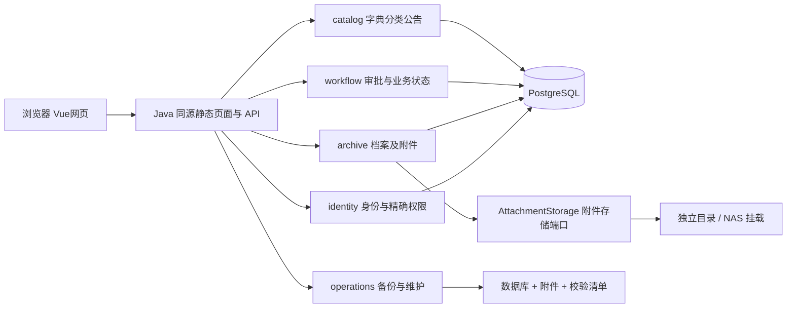

# Java 档案模块架构与边界

## 已确认的范围

- 信息管理系统未来包含首页、公盘和档案；本轮只重构档案及其必要支撑能力。
- 数据库尚未正式使用，新库初始化，不做旧数据迁移。
- 用户后续确认改为Web形式：主前端为Vue 3 + TypeScript + Element Plus；PySide6代码保留作历史对照，不要求用户安装。
- 初期 Windows 内网，之后 Linux；用户从几人增长至约100人。人数不等于并发量，目前没有100人并发性能验收结论。
- 先修复现有功能，不将接收审批、鉴定暂缓、整理移交、知识库引用等规划功能默认为已完成。

## 技术选择

采用可独立部署的模块化单体，避免这一规模下引入多服务运维与分布式事务。Java 编译目标为21，Spring Boot版本固定4.1.1；数据库固定PostgreSQL，使用参数化JDBC及Flyway迁移。选择PostgreSQL是为统一事务、行锁、备份恢复和跨平台部署方式，不表示MySQL不能实现这些业务。

版本兼容依据：[Spring Boot官方系统要求](https://docs.spring.io/spring-boot/system-requirements.html)。PostgreSQL Windows发行包由[官方安装入口](https://www.postgresql.org/download/windows/)指向EDB。具体投产补丁版本应在部署时按公司维护规范确认。

## 模块职责

网页位于`web/`，按档案、业务办理、审批、组织与运维分页面。身份及API请求集中在`src/lib/api.ts`，通用表单和表格位于`components/`。路由采用哈希模式，刷新子页面无需服务器通配回退。构建结果放入JAR的`static/`，浏览器无需第三方CDN。API继续要求Bearer认证；网页启动时验证身份，令牌只放当前页签的sessionStorage，账号切换后的旧响应被丢弃。CSP限制外部脚本，业务文本不作为原始HTML渲染。

| 模块 | 负责内容 | 未来接入方式 |
|---|---|---|
| identity | 登录、会话、部门、用户、角色及功能权限 | `IdentityProvider` / `Actor` 是统一身份边界，替换认证来源并映射稳定身份；不能直接混用两套账号ID |
| archive | 档案登记、查询、归档、变更留痕、授权、文件版本 | `ArchiveAccess` 统一对象范围；附件通过 `AttachmentStorage` 替换存储适配器 |
| workflow | 模板、节点、会签、待办、借阅/销毁/损坏状态 | 状态变更与审批结论在同一数据库事务内完成 |
| catalog | 字典、编号规则、分类、公告和审计读取 | 保持档案业务目录边界；未来公告可迁移为平台服务 |
| operations | 完整性检查、整体备份、隔离恢复工具 | 单实例维护窗口；恢复到新库与新目录后切换配置 |
| shared | 响应、输入校验、数据访问、审计和异常边界 | 仅技术基础设施，不放业务状态判断 |

## 权限模型

每次请求先解析服务端会话，再验证**功能权限 + 对象范围**。默认可访问本部门档案；跨部门需对人/部门明确授予某个动作，或具备`archive.manage.all`并同时有该动作权限。`archive.admin`只负责档案管理配置，不是权限通配符。

查看、编辑、预览、下载、上传、借阅申请/审批、销毁申请/审批/执行分别判断。只分享查看不会自动分享下载或借阅。共享受有效期限制，撤销后下一次请求生效；共享编辑者不能改变归属部门后再次转授。

列表、详情、聚合统计、附件、审批和网页入口都执行范围校验。页面隐藏按钮仅辅助交互，服务端仍独立检查。当前使用应用层范围过滤，并未声称启用了PostgreSQL行级安全策略。

登录凭证为随机不透明令牌，数据库只保存其SHA256摘要；每次请求实时读取账号状态和权限。退出、改密、停用及授权变更会使相关凭证失效。浏览器Cookie仅用于`/web`，REST写接口必须显式发送Bearer请求头。跨部门人员选择使用最小目录投影，不放宽账号管理权限。

## 状态与记录

- 新档案固定草稿；普通PUT不能改生命周期状态，归档通过专用动作完成，真实经办人由当前身份写入。
- 文件按同名递增版本，上传新版本不覆盖旧文件；保留文件大小、哈希、上传人、时间和当前版本标志。
- 借阅提交时逐档案检查审批路由。混合路由批次拒绝并提示拆分，缺少有效审批人时回滚申请，不自动批准。
- 纸质/混合借阅：申请 → 审批 → 办理借出 → 归还；电子借阅保留记录流程。本轮**未实现按借阅期限自动授予/撤销下载权限**，电子访问仍由显式授权控制，后续需独立设计。
- 通用待办审批同时更新业务单；审批动作仍校验当前业务审批权限、节点参与者和每份档案范围。
- 销毁执行必须与获批清单完全一致，使用行锁/唯一约束防重复执行；保存申请、执行批次、见证人与快照，档案逻辑销毁后禁止普通访问。不能把到期当自动删除。
- 损坏登记及每次处理都追加历史；正式内容更正可追溯，不静默覆盖事实。

当前销毁是业务状态和留痕操作，**不会证明纸质原件已物理销毁，也不会自动清除磁盘/备份中的电子副本**。实物执行、备份保留和法律保管要求须按公司制度办理。

## 接口兼容与有意调整

继续使用`/api/auth`、`/api/users`、`/api/departments`、`/api/roles`、`/api/system`、`/api/categories`、`/api/archives`、`/api/files`、`/api/approval`、`/api/borrows`、`/api/destroys`、`/api/damages`、`/api/notices`、`/api/logs`、`/api/security`及`/web`入口。JSON信封保持`code/message/data`及snake_case字段。

有意调整：会话不再是JWT；密码12–128字符；修改密码后重新登录；新增实物借出及共享接口；销毁只执行完整获批清单；损坏状态为reported/processing/resolved/closed；备份包含数据库和全部附件；网页退出采用POST；在线恢复返回409及停服恢复说明。旧服务器安装器不能打包Java服务。

## 数据与维护

V1身份、V2档案、V3工作流、V4目录种子由Flyway顺序应用，迁移错误阻止启动。投产后新增迁移，不编辑已执行版本。时间点使用带时区字段，业务日期单独保存。附件和备份目录不相互包含，不把存储路径暴露给下载调用者。

整体备份的维护门禁排空在途HTTP请求后，冻结本实例新请求，验证附件、调用pg_dump、打包全部版本及SHA256清单，再回读校验。这个一致性条件要求**单服务实例，且没有其他程序直接写数据库或附件目录**。多实例或公盘接入前，需要改用跨实例维护协调与一致性快照机制。

恢复使用独立JDK工具，仅接受新空库与不存在的新附件目录。完成内容核验后由管理员验收和切换配置，原库和原附件保留。成功备份不替代恢复演练。

## 中文注释约定

本轮新增/重构的接口、类、方法、参数、字段、局部变量、配置及数据库结构使用中文说明；接口解释权限、输入输出与状态限制，复杂方法解释事务及失败语义，配置解释单位和作用。业务规则变化必须同步修改注释，禁止只增加“这是变量”等无信息注释。历史Python服务保留作参考，不将其注释视为新服务契约。

## 后续阶段

先以公司实际角色和档案样例验收现有功能，再优化界面；随后接入统一身份、首页、公盘。接收审批、整理移交、保管暂缓/鉴定、电子档案限时授权、下载副本管理及知识库按具体版本引用均需单独需求与测试。正式内网发布前还需部署TLS、设置备份保留策略、完成真实业务验收和目标负载测试。
